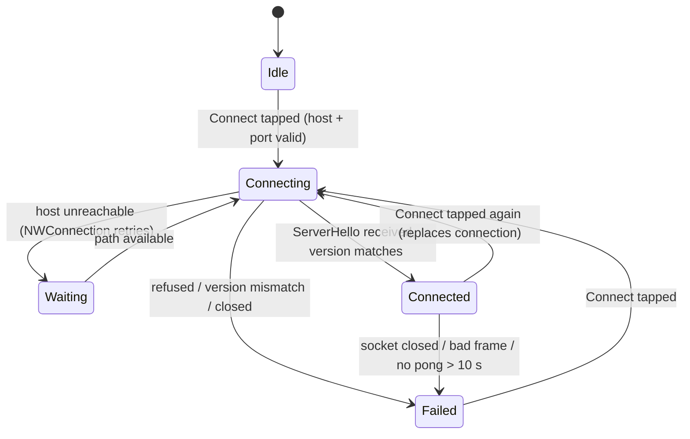

# SoloDolo — System Architecture

**Dolo**, on a Raspberry Pi, decodes ADS-B traffic and reads GNSS. It streams both over TCP to **Solo**, an iPad dashboard.
The two halves share exactly one artifact: the wire contract `proto/solodolo/v1/solodolo.proto`.

Sections marked *(planned)* describe intended behavior that isn't built yet. Everything else matches the code as of this revision.

## 1. System overview

```mermaid
flowchart LR
    subgraph RF["RF / Sensors"]
        ANT1(["1090 MHz antenna"])
        ANT2(["GNSS antenna"])
    end

    subgraph PI["Raspberry Pi — Dolo"]
        direction TB
        SDR["NooElec RTL-SDR<br/>(USB)"]
        GNSSHW["GNSS module<br/>e.g. GT-U7 on UART"]

        DUMP["dump1090-mutability<br/>SBS on localhost:30003"]
        GPSD["gpsd :2947<br/>(alternative source)"]

        DOLO["dolo (C++20, epoll)<br/>merge · range/bearing · 1 Hz snapshots<br/>:5555 protobuf · :5556 NDJSON debug"]
        AVAHI["avahi<br/>mDNS: _solodolo._tcp"]

        SDR --> DUMP
        DUMP -->|SBS lines| DOLO
        GNSSHW -->|NMEA, /dev/ttyAMA0| DOLO
        GNSSHW -.->|or| GPSD
        GPSD -.->|TPV / SKY JSON| DOLO
    end

    subgraph NET["Network"]
        LINK[["Ethernet (USB-C adapter)<br/>or shared LAN"]]
    end

    subgraph IPAD["iPad — Solo"]
        direction TB
        CONNECT["Connect screen<br/>host + port entry"]
        CONN["BridgeConnection<br/>NWConnection TCP client"]
        PARSE["FrameDecoder +<br/>swift-protobuf"]
        STATE["Observable state<br/>GPSStatus · TrafficSnapshot · Ownship"]
        UI["SwiftUI dashboard<br/>Map · GPS gumballs · closest-5 table"]
        CONNECT --> CONN --> PARSE --> STATE --> UI
    end

    ANT1 --> SDR
    ANT2 --> GNSSHW
    DOLO <--> LINK <--> CONN
    AVAHI -.->|advertised; Solo discovery planned| CONNECT
```



**Not built yet:**
- PPS time discipline (chrony). Dolo always reports `pps_locked: false`.
- A DHCP server on the Pi's `eth0`. The Pi and iPad currently need to share a network that hands out addresses.
- Bonjour discovery in Solo. Dolo advertises `_solodolo._tcp`, but Solo connects to a typed host and port.

## 2. Repository layout

| Path | What it is |
|---|---|
| `proto/solodolo/v1/solodolo.proto` | Wire contract. The single source of truth for both halves. |
| `dolo/` | Pi bridge (C++20, CMake). Self-contained: it never reads anything under `solo/`. See `dolo/README.md`. |
| `dolo/deploy/` | `install.sh`, `start.sh`, systemd unit, avahi service record |
| `solo/` | iPad app sources (Xcode target `SoloDolo`) |
| `solo/Generated/solodolo.pb.swift` | Swift code generated from the `.proto`. Don't edit by hand. |
| `scripts/generate-proto.sh` | Regenerates the Swift code. Run it after changing the `.proto`. |
| `SoloDolo.xcodeproj` | Xcode project; depends on `apple/swift-protobuf` 1.40.x via SPM |
| `docs/` | This document |

### Solo source map

| File | Responsibility |
|---|---|
| `App/SoloDoloApp.swift` | Entry point; owns the single shared `BridgeConnection` |
| `Networking/BridgeConnection.swift` | TCP connection, handshake, receive loop, keepalive; publishes `status`, `gps`, `traffic` |
| `Networking/FrameCodec.swift` | 4-byte length-prefix framing; 1 MiB frame limit |
| `Networking/EndpointValidation.swift` | Host (IPv4 or hostname) and port (1–65535) validation |
| `Models/GPSStatus.swift` | Fix, satellites, HDOP, PPS, position, and their quality thresholds |
| `Models/Ownship.swift` | Ownship position: the GPS fix, or the assumed location |
| `Models/NearbyAircraft.swift` | Distance/bearing from ownship; sorting by distance |
| `Views/ContentView.swift` | Connect screen; opens the dashboard once connected |
| `Views/DashboardView.swift` | Map + GPS tiles, ADS-B table below |
| `Views/TrafficMap.swift`, `GPSStatusPanel.swift`, `TrafficPanel.swift` | The three dashboard tiles |
| `Views/ConnectionIndicator.swift`, `StatusDot.swift`, `ValidatedFieldStyle.swift` | Shared UI pieces |

## 3. Connection and data flow

```mermaid
sequenceDiagram
    autonumber
    participant D as dump1090-mutability
    participant G as GNSS (NMEA serial or gpsd)
    participant B as dolo (Pi)
    participant I as Solo (iPad)

    Note over B: systemd starts dump1090, then dolo
    B->>D: connect localhost:30003 (retries every 5 s)
    B->>G: open /dev/ttyAMA0, or gpsd ?WATCH

    I->>B: TCP connect :5555 (host/port typed by the user)
    I->>B: Envelope{ClientHello{protocol_version: 1, app_version}}
    Note over B: drops clients with no ClientHello within 10 s,<br/>or with an unsupported protocol_version
    B-->>I: Envelope{ServerHello{protocol_version, bridge_version, capabilities, pps_locked}}
    B-->>I: replay of the latest GnssFix / TrafficSnapshot

    loop Continuous
        G-->>B: position / fix updates
        B-->>I: Envelope{GnssFix} (on each GNSS update)
        D-->>B: SBS MSG,1…8
        B->>B: merge per ICAO, prune after 60 s,<br/>range/bearing from GNSS or ownship_fallback
        B-->>I: Envelope{TrafficSnapshot{aircraft[]}} @ traffic_hz (1 Hz)
    end

    loop Every 5 s (after ServerHello)
        I->>B: Envelope{Ping{seq}}
        B-->>I: Envelope{Pong{seq}}
    end

    Note over I: No pong for 10 s, a bad frame, or a closed socket<br/>→ status "failed"; GPS and traffic are cleared
```

Dolo keeps at most 8 queued frames per client. A slow client loses its oldest unsent frames rather than stalling the server.

## 4. Solo connection states

### As built



The status drives the gumball color: blue for idle or connecting, orange for waiting, green for connected, red for failed.
The dashboard opens automatically on **Connected**. Tapping the "D" gumball returns to the connect screen; the connection stays open.

### Planned

- **Discovering:** browse for `_solodolo._tcp`, and fall back to the typed address.
- **Stale:** no data for more than 3 s while still connected.
- **Backoff:** reconnect automatically after 1 s, 2 s, 4 s… up to 30 s, instead of stopping at **Failed**.

## 5. Wire protocol

Protocol Buffers (proto3) over one TCP socket per client. Port 5555 is protobuf; port 5556 is a read-only NDJSON mirror for debugging.
Dolo generates its C++ code with `protoc` at build time. Solo commits generated Swift (`scripts/generate-proto.sh`, protoc-gen-swift 1.40.0), which has to stay in step with the SwiftProtobuf package version.

### Framing

```
┌──────────────────────────┬──────────────────────────────┐
│ uint32 length (4 bytes,  │ Envelope (protobuf bytes,    │
│ big-endian)              │ `length` bytes)              │
└──────────────────────────┴──────────────────────────────┘
```

- Frames over **1 MiB** are rejected on both sides, and the connection is dropped.
- Every frame is exactly one `Envelope`, which carries `sent_unix_ms` and a `oneof payload`.
- Solo reads up to 64 KiB at a time and lets `FrameDecoder` split or join reads into whole frames.

### Messages

The `.proto` file is authoritative; this table is a summary.

| Payload | Direction | When | Key fields |
|---|---|---|---|
| `ClientHello` (10) | Solo → Dolo | First frame after connecting | `protocol_version` (1), `app_version` e.g. "1.0 (1)" |
| `ServerHello` (11) | Dolo → Solo | Reply to `ClientHello` | `protocol_version`, `bridge_version`, `capabilities` (GNSS, TRAFFIC), `pps_locked` |
| `GnssFix` (20) | Dolo → Solo | Each GNSS update, plus a replay after the handshake | `fix_mode`, lat/lon (2D/3D fix only), `satellites_used/visible`, optional `hdop`, altitude, speed, track |
| `TrafficSnapshot` (21) | Dolo → Solo | Every 1/`traffic_hz` s | `aircraft[]` (full picture, not deltas), `messages_total` |
| `Ping` (30) / `Pong` (31) | Solo → Dolo / back | Every 5 s | `seq` echoed back |

Each `Aircraft` has: `icao_address`, and optional `callsign`, `squawk`, lat/lon, baro/geom altitude, ground speed, track and vertical rate.
It also has `on_ground`, freshness fields (`seen_s`, `seen_pos_s`, `rssi_dbfs`), and Dolo-computed `range_nm`, `bearing_true_deg` and `relative_alt_ft`.

### Schema rules

- **Never reuse or renumber field tags.** To retire a field, add `reserved <tag>;` and `reserved "<name>";`.
- New fields are `optional` or have a safe default, so older peers keep working.
- Bump `protocol_version` (Dolo `kProtocolVersion`, Solo `BridgeConnection.protocolVersion`) only for breaking changes.
- Generated code is never hand-edited. Dolo regenerates on every build; Solo runs `scripts/generate-proto.sh`.

### Debugging

```bash
nc <pi-address> 5556
# {"sentUnixMs":"1794420000123","traffic":{"aircraft":[{"icaoAddress":10597059,"callsign":"UAL123",...}]}}
```

Port 5556 sends the same `Envelope`s in protobuf's JSON mapping. Set `server.debug_port: null` in `dolo.yaml` to turn it off.

## 6. Ownship, range and bearing

Each half computes range and bearing independently, using the same rule:

| | With a 2D/3D GNSS fix | Without a fix |
|---|---|---|
| **Dolo** (`range_nm`, `bearing_true_deg` in each `Aircraft`) | GNSS position | `ownship_fallback` in `dolo.yaml` |
| **Solo** (map, ADS-B table) | `GnssFix` lat/lon | `Ownship.assumedLocation`: Lewisville City Hall, 33.0462, -96.9942 |

- Solo ignores `GnssFix` lat/lon unless `fix_mode` is 2D or 3D. Without a fix they arrive as proto3 zeros.
- Losing the fix moves Solo back to the assumed location, not to the last known position.
- Solo computes distance (CoreLocation, in nautical miles) and initial great-circle bearing on the iPad, from each aircraft's lat/lon. Aircraft without a decoded position are left off the map and the table.
- The two fallback locations differ by about 0.35 mi. Set them to the same point to make Dolo's and Solo's numbers agree.

## 7. Dashboard

| Tile | Content |
|---|---|
| Connection gumball "D" (top-left) | Connection status color; tap to return to the connect screen |
| Map (square) | Ownship dot (blue = GPS, gray = assumed) and every positioned aircraft, rotated to its track (orange airborne, gray on ground). It starts about 30 nm across and recentres only when the fix is gained or lost. |
| GPS (square) | Four gumballs; thresholds below |
| ADS-B (full width) | Closest 5 aircraft: callsign (or ICAO hex), distance, bearing, altitude (or GND), speed, track, squawk |

| GPS gumball | Green | Orange | Red | Gray |
|---|---|---|---|---|
| Fix | 3D | 2D | No fix | No data |
| Satellites (used) | 6 or more | 4–5 | fewer than 4 | No data |
| HDOP | 2 or less | up to 5 | over 5 | No data |
| PPS | Locked | Unlocked | — | No data |

## 8. Decisions

| Topic | Decision | Alternatives considered |
|---|---|---|
| Bridge language | C++20 with a single-threaded epoll loop (`dolo/`) | Python (asyncio), Go, Rust |
| Wire encoding | Protobuf (proto3), 4-byte big-endian length prefix | Varint prefix (`writeDelimitedTo`); NDJSON |
| Protobuf toolchain | libprotobuf + `protoc` at build time (Dolo); swift-protobuf 1.40 via SPM with committed generated code (Solo) | SwiftProtobuf build plugin; `buf` for linting and breaking-change checks |
| Traffic updates | Full snapshot at 1 Hz | Per-aircraft deltas (only if the link gets slower) |
| Debug visibility | NDJSON copy of the stream on :5556 | Debug-build-only switch in Solo |
| ADS-B source | `dump1090-mutability` SBS on localhost:30003 | dump1090-fa; polling `aircraft.json` |
| GNSS source | NMEA straight from the serial port (`gnss.source: serial`), or gpsd | gpsd only |
| Solo addressing | Typed host/port (defaults 192.168.50.1:5555) | Bonjour discovery *(planned)*; DHCP on the Pi's eth0 *(planned)* |
| iPad network | USB-C Ethernet adapter (ideally with PD passthrough), or a shared LAN | Lightning adapter on older iPads |
| Time source | System clock; PPS via chrony *(planned)* | NTP only |
| iOS permissions | `NSLocalNetworkUsageDescription`; `NSBonjourServices = _solodolo._tcp` | — |

## 9. Known gaps

- **Solo:** no automatic reconnect or backoff, no Stale state, no Bonjour discovery, no Disconnect button (leaving the dashboard keeps the link open), and no unit tests.
- **Dolo:** PPS lock is never reported. The gpsd path is tested only against canned messages.
- **End-to-end:** Solo has been tested against a local fake Dolo, not yet against a real Pi.
