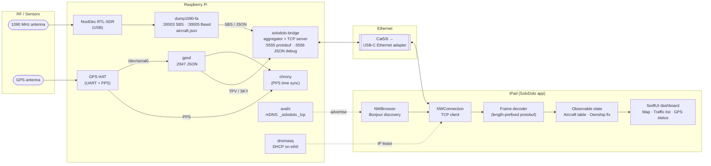
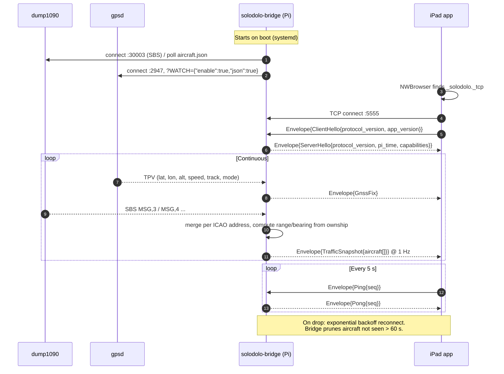
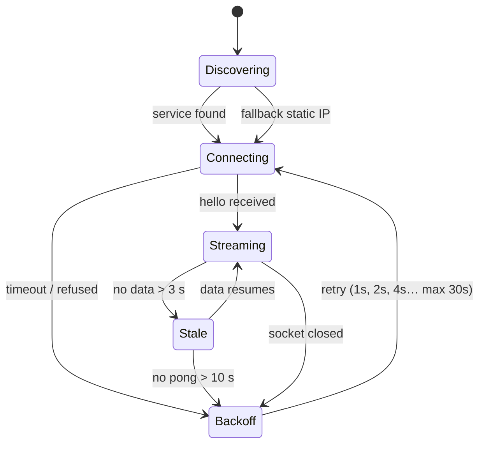

# SoloDolo — System Architecture (Draft)

Raspberry Pi collects ADS-B and GNSS data and streams it to an iPad dashboard over wired Ethernet (TCP).

## 1. System overview



## 2. Connection & data flow



## 3. iPad connection states



## 4. Wire protocol (proposed)

Protocol Buffers (proto3) over a single TCP socket. One `.proto` file generates the Pi bridge code (Python or Go) and the iPad code (swift-protobuf via Swift Package Manager).

### Framing

Protobuf doesn't mark where one message ends on a stream, so every frame gets a length prefix:

```
┌──────────────────────────┬──────────────────────────────┐
│ uint32 length (4 bytes,  │ Envelope (protobuf bytes,    │
│ big-endian)              │ `length` bytes)              │
└──────────────────────────┴──────────────────────────────┘
```

- A fixed 4-byte prefix suits `NWConnection.receive(minimumIncompleteLength:maximumLength:)`: read exactly 4 bytes, then exactly `length` bytes.
- Reject frames over **1 MiB**. A bad length then can't make the app allocate huge buffers.
- Every frame is an `Envelope`, so the receiver never has to guess what type it got.

### Schema: `proto/solodolo/v1/solodolo.proto`

```protobuf
syntax = "proto3";

package solodolo.v1;

option swift_prefix = "SD";

// Every frame on the wire is exactly one Envelope.
message Envelope {
  uint64 sent_unix_ms = 1;   // sender's clock when the frame was sent
  oneof payload {
    ClientHello     client_hello = 10;
    ServerHello     server_hello = 11;
    GnssFix         gnss         = 20;
    TrafficSnapshot traffic      = 21;
    Ping            ping         = 30;
    Pong            pong         = 31;
  }
}

// ---- Handshake -------------------------------------------------------------

message ClientHello {
  uint32 protocol_version = 1;   // currently 1
  string app_version      = 2;   // e.g. "1.0 (42)"
}

message ServerHello {
  uint32 protocol_version     = 1;
  string bridge_version       = 2;
  repeated Capability capabilities = 3;
  bool   pps_locked           = 4;   // Pi clock disciplined by GPS PPS
}

enum Capability {
  CAPABILITY_UNSPECIFIED = 0;
  CAPABILITY_GNSS        = 1;
  CAPABILITY_TRAFFIC     = 2;
}

// ---- Ownship GNSS ----------------------------------------------------------

message GnssFix {
  FixMode fix_mode   = 1;
  uint64  fix_unix_ms = 2;          // GPS time of fix
  double  latitude_deg  = 3;
  double  longitude_deg = 4;
  optional float altitude_msl_m = 5; // absent without a 3D fix
  optional float ground_speed_kt = 6;
  optional float track_true_deg  = 7;
  optional float climb_fpm       = 8;
  uint32  satellites_used    = 9;
  uint32  satellites_visible = 10;
  optional float hdop = 11;
  optional float vdop = 12;
  optional float horizontal_error_m = 13;  // gpsd eph
}

enum FixMode {
  FIX_MODE_UNSPECIFIED = 0;
  FIX_MODE_NO_FIX      = 1;
  FIX_MODE_2D          = 2;
  FIX_MODE_3D          = 3;
}

// ---- ADS-B traffic ---------------------------------------------------------

// Full picture of the sky, sent at 1 Hz. Aircraft that drop out of a snapshot
// are gone. That's simpler than sending add/update/remove deltas, and the size is fine on Ethernet.
message TrafficSnapshot {
  repeated Aircraft aircraft = 1;
  uint64 messages_total = 2;   // dump1090 message counter (receiver health)
}

message Aircraft {
  uint32 icao_address = 1;            // 24-bit ICAO, e.g. 0xA1B2C3
  optional string callsign = 2;       // trimmed, e.g. "UAL123"
  optional string squawk = 3;         // 4 octal digits as text, e.g. "1200"

  // Position (absent until a CPR position decode succeeds)
  optional double latitude_deg  = 4;
  optional double longitude_deg = 5;

  optional int32 altitude_baro_ft = 6;
  optional int32 altitude_geom_ft = 7;
  optional float ground_speed_kt  = 8;
  optional float track_true_deg   = 9;
  optional int32 vertical_rate_fpm = 10;
  bool  on_ground = 11;

  // Freshness / signal
  float seen_s     = 12;   // seconds since any message
  optional float seen_pos_s = 13;   // seconds since last position
  optional float rssi_dbfs  = 14;

  // Computed on the Pi relative to the current ownship fix
  optional float range_nm         = 15;
  optional float bearing_true_deg = 16;
  optional int32 relative_alt_ft  = 17;
}

// ---- Keepalive -------------------------------------------------------------

message Ping { uint32 seq = 1; }
message Pong { uint32 seq = 1; }
```

### Schema rules

- **Never reuse or renumber field tags.** To retire a field, add `reserved <tag>;` and `reserved "<name>";`.
- New fields are always `optional`, or have a safe default value, so older apps keep working.
- Bump `protocol_version` only for breaking changes. The bridge closes the connection if `ClientHello.protocol_version` is one it doesn't support.
- The `.proto` file lives in this repo and is the single source of truth. Generated code isn't hand-edited.

### Debugging

The binary stream can't be read with `nc`, so the bridge also serves **the same `Envelope`s as newline-delimited JSON on port 5556**, using protobuf's standard JSON mapping (`MessageToJson` / `jsonString()`):

```bash
nc 192.168.50.1 5556
# {"sentUnixMs":"1794420000123","traffic":{"aircraft":[{"icaoAddress":10597059,"callsign":"UAL123",...}]}}
```

Only the iPad app uses port 5555. Port 5556 is read-only and can be turned off in production.

## 5. Notes / decisions to make

| Topic | Default proposal | Alternatives |
|---|---|---|
| Bridge language | C++20 (epoll), see `dolo/` | Python, Go, Rust |
| Wire encoding | Protobuf (proto3), 4-byte big-endian length prefix | Varint prefix (`writeDelimitedTo`); NDJSON |
| Protobuf toolchain | `protoc` + swift-protobuf (SPM) on iOS; libprotobuf (C++) on Pi | `buf` for linting and breaking-change checks |
| Traffic updates | Full snapshot @ 1 Hz | Per-aircraft deltas (only if the link gets slower) |
| Debug visibility | JSON copy of the stream on :5556 | Debug-build-only switch on the iPad |
| ADS-B source | SBS :30003 stream | Poll `aircraft.json` (simpler, already decoded) |
| Pi ↔ iPad addressing | Pi runs DHCP on eth0 (e.g. 192.168.50.1) + mDNS | Static IPs on both |
| iPad Ethernet | USB-C Ethernet adapter (ideally w/ PD passthrough) | Lightning adapter on older iPads |
| Time source | GPS + PPS via chrony | NTP only |
| iOS permissions | `NSLocalNetworkUsageDescription`, `NSBonjourServices = _solodolo._tcp` | — |
