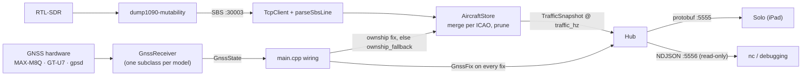
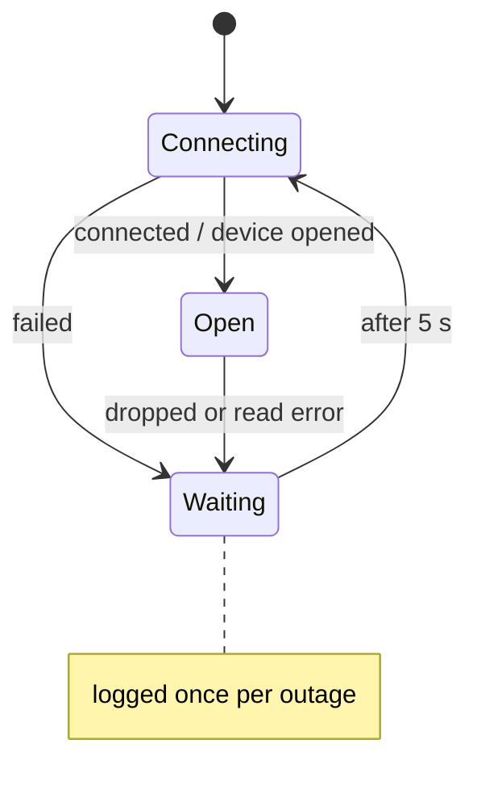
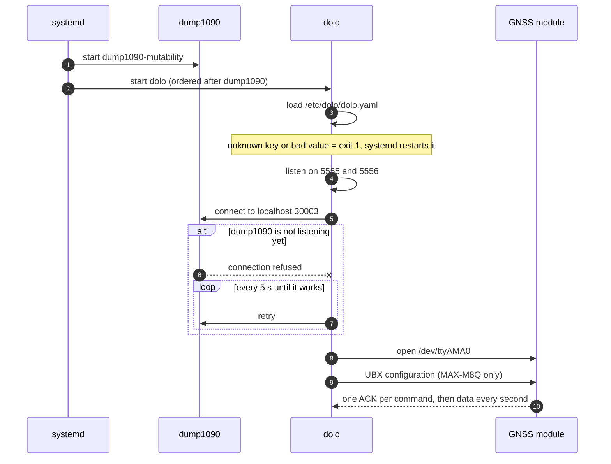
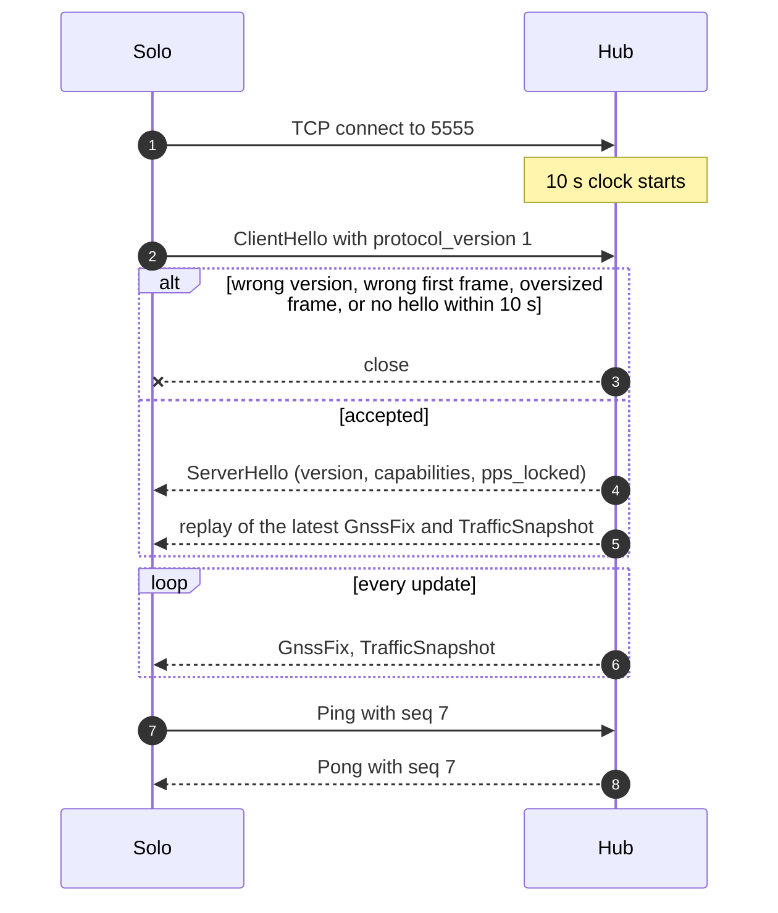
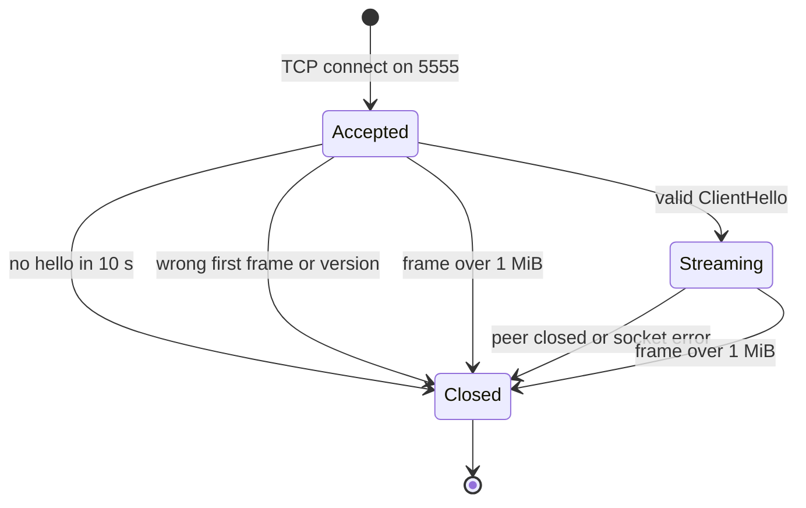
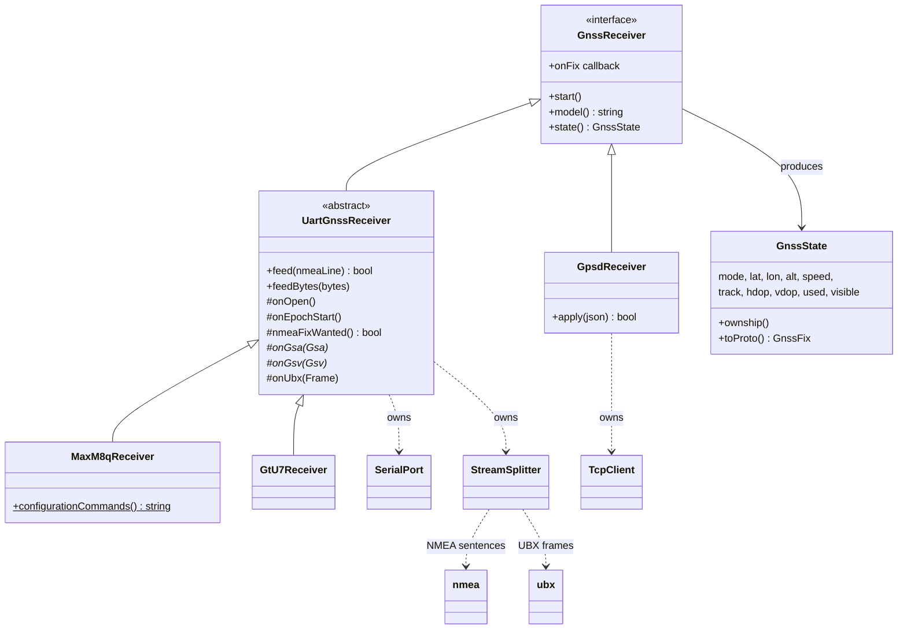
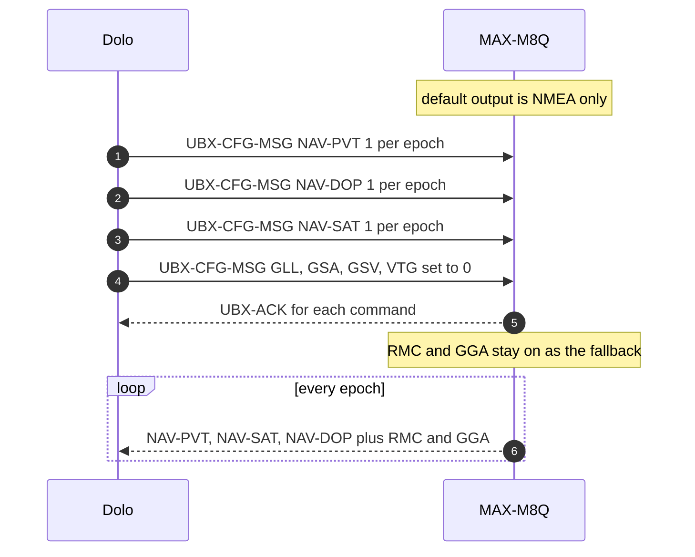
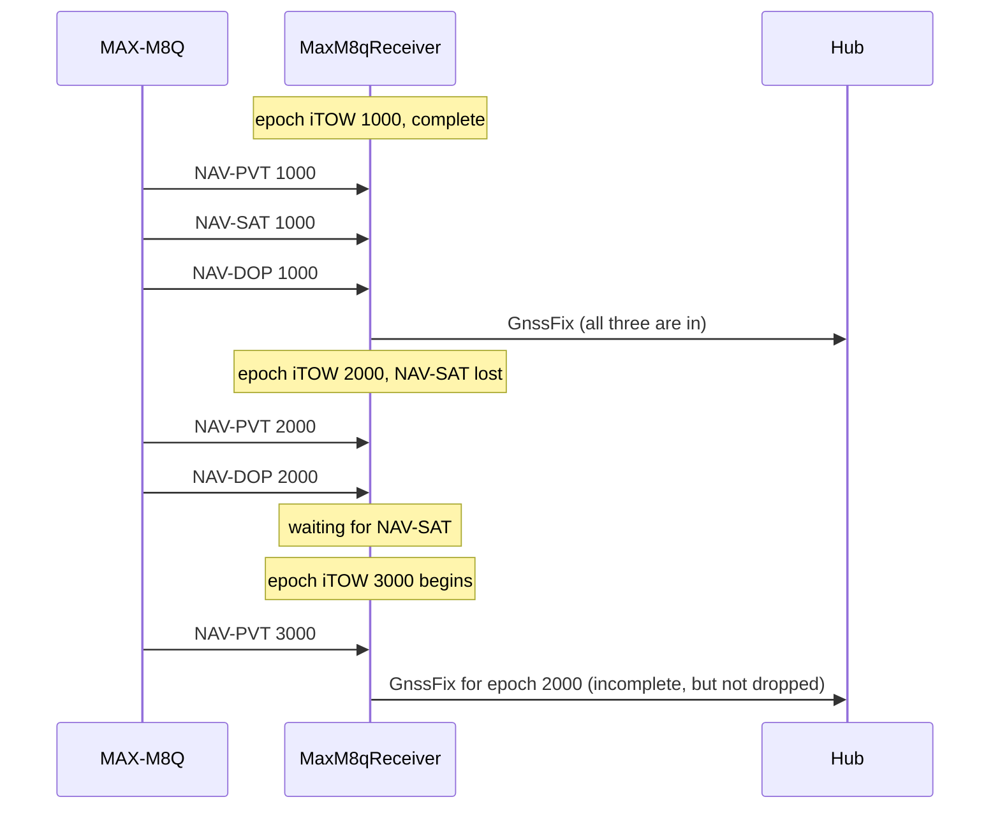
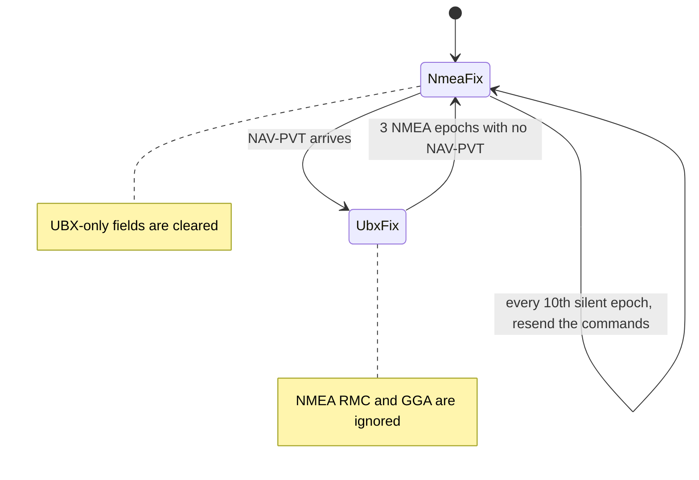

# Dolo architecture

Dolo is the Raspberry Pi half of SoloDolo. For the whole system (RF chain, iPad app, wire protocol) see
[`../docs/architecture.md`](../docs/architecture.md). This document is about what is inside Dolo.

- [What Dolo does](#what-dolo-does)
- [Data flow](#data-flow)
- [Execution model](#execution-model)
- [Timing](#timing)
- [Components](#components)
- [Hub: talking to Solo](#hub-talking-to-solo)
- [Traffic](#traffic)
- [GNSS](#gnss-one-class-per-piece-of-hardware)
- [Configuration and deployment](#configuration-and-deployment)
- [Testing](#testing)

## What Dolo does

- Reads aircraft from `dump1090-mutability` (SBS text on `localhost:30003`).
- Reads the receiver's own position from a GNSS module (or gpsd).
- Merges aircraft by ICAO address and computes range and bearing from our own position.
- Streams both to the Solo iPad app: protobuf on `:5555`, a JSON copy on `:5556` for debugging.

Boundaries:
- Dolo never reads anything from `solo/` (the iOS app).
- The only shared file is the wire contract `../proto/solodolo/v1/solodolo.proto`.
  CMake generates the C++ from it at build time, and nothing generated is committed.
- ADS-B decoding stays in `dump1090-mutability`. Dolo only consumes its text output.

## Data flow



- `main.cpp` only wires things together:
  - builds the receiver from the config
  - connects the receiver's `onFix` to `Hub::broadcast`
  - runs a timer that turns the `AircraftStore` into a `TrafficSnapshot`, using the latest ownship position

## Execution model

- **One thread, one `epoll` loop** (`core/event_loop.*`). There are no locks because nothing runs concurrently.
- **Everything is non-blocking:**
  - the SBS client, the gpsd client and the serial port
  - the two listening sockets and every client connection
  - timers: traffic snapshots, the hub's hello-timeout sweep, reconnect retries
- **Rule for callbacks:** never block. Slow work does not belong in Dolo.
- **Inputs reconnect forever:** a dropped socket or a missing serial device is retried every 5 s, and the outage is
  logged once instead of on every retry.



## Timing

### Startup



- systemd only orders the *start* of the two units, not "dump1090 is listening", which is why the SBS retry exists.
- A missing serial device is also retried every 5 s, so Dolo can start before the UART is available.

### A client connecting



- The replay means a new or reconnecting app has data immediately instead of waiting for the next update.
- Debug viewers on `:5556` skip the handshake entirely and just receive the JSON stream.

### One second of output

Two independent clocks drive what Solo receives. Neither waits for the other.

```text
time ->      0 s        1 s        2 s        3 s        4 s        5 s
GnssFix      *          *          *          *          *          *      one per GNSS epoch (the module's clock)
Traffic        *          *          *          *          *               one per 1/traffic_hz (Dolo's timer)
Ping (Solo)  *                                                    *        every 5 s, answered with a Pong
```

- GNSS phase comes from the receiver; traffic phase comes from when Dolo started.
- With no GNSS fix, traffic still flows: range and bearing then use `ownship_fallback`.

## Components

Source is grouped by function. Dependencies point one way:

```text
core  <-  io  <-  adsb / gnss / server  <-  app
```

- The three feature folders never include each other. `adsb` and `gnss` share only the plain `Ownship` struct in
  `core/ownship.hpp`.
- Only `app` knows about the config file. `gnss/` takes its own `GnssSettings` struct, which `app/config` fills in.
- Each folder is its own CMake static library with its own `CMakeLists.txt`:
  `dolo_core`, `dolo_io`, `dolo_adsb`, `dolo_gnss`, `dolo_server`, `dolo_config`, plus `dolo_proto` for the generated
  protobuf code.
- The link dependencies between libraries are exactly the arrows above, so a folder cannot quietly start using one
  it should not.
- The `dolo` executable (`app/main.cpp`) and `dolo_tests` link the libraries they use.

| Folder | Contents |
|---|---|
| `core/` | `event_loop.*` (epoll reactor, timers, SIGINT/SIGTERM shutdown), `clock.hpp`, `log.hpp`, `ownship.hpp` |
| `io/` | `net.*` (non-blocking listener, reconnecting line-oriented `TcpClient`), `serial.*` (reconnecting `SerialPort`, raw bytes in and out) |
| `adsb/` | `sbs.*` (parses dump1090 lines), `aircraft.*` (`AircraftStore`: merge per ICAO, prune, build `TrafficSnapshot`), `geo.hpp` (range and bearing) |
| `gnss/` | GNSS receiver abstraction, see below |
| `server/` | `hub.*` (handshake, keepalive, fan-out, JSON mirror), `framing.hpp` (4-byte big-endian length prefix, 1 MiB cap) |
| `app/` | `main.cpp` (wiring only) and `config.*` (YAML; unknown keys and bad values are rejected at startup) |

## Hub: talking to Solo



- **Handshake:** the first frame must be a `ClientHello` with a matching protocol version.
- **Replay:** after the handshake the client gets a `ServerHello`, then the latest `GnssFix` and `TrafficSnapshot`.
- **Back-pressure:** each client has a queue of at most 8 whole frames.
  - A slow client loses its *oldest* unsent frames.
  - It never stalls the other clients, and memory stays bounded.
- **Debug mirror:** port 5556 sends the same `Envelope`s as newline-delimited JSON and ignores anything it receives.
- **PPS:** `pps_locked` in `ServerHello` is always `false`, because Dolo does not discipline the clock from PPS.

## Traffic

- `AircraftStore` keeps only what dump1090 sends, merged by ICAO address.
- A full `TrafficSnapshot` goes out every `1/traffic_hz` seconds. Aircraft missing from a snapshot are gone.
- Tracks not heard from for `prune_after_s` (60 s) are dropped.
- Range, bearing and relative altitude are relative to the ownship fix:
  - with a usable fix, they use it
  - otherwise they use `ownship_fallback` from the config
  - with neither, they are omitted

## GNSS: one class per piece of hardware

GNSS parts will be swapped, so everything else in Dolo depends on one small interface and never on a model.



| Piece | What it knows |
|---|---|
| `gnss/nmea.*` | NMEA 0183 syntax only: checksum, fields, RMC/GGA/GSA/GSV. No hardware knowledge, no state |
| `gnss/ubx.*` | u-blox UBX syntax only: frames, checksum, `UBX-CFG-MSG`, NAV-PVT/DOP/SAT decoders. No hardware knowledge, no state |
| `gnss/stream.*` | `StreamSplitter`: cuts the UART bytes into NMEA sentences and checksummed UBX frames (UBX payloads can contain newlines, so splitting on lines is not enough) |
| `gnss/state.*` | `GnssState`: the receiver-independent result, and its mapping to the `GnssFix` protobuf |
| `gnss/receiver.hpp` | `GnssReceiver`, the only GNSS type `main.cpp` uses |
| `gnss/uart_receiver.*` | `UartGnssReceiver`: owns the port and splitter, the RMC/GGA mapping every NMEA module shares, and the NMEA publish rule (one `GnssFix` per GGA) |
| `gnss/max_m8q.*` | u-blox MAX-M8Q: UBX first, NMEA fallback (below) |
| `gnss/gt_u7.*` | u-blox GT-U7: GPS only, NMEA only, one GSA and one GSV group per epoch |
| `gnss/gpsd.*` | gpsd's TPV/SKY JSON, for any receiver gpsd already supports |
| `gnss/factory.*` | maps `gnss.receiver` in the config to a class |

To add a model:
1. Subclass `UartGnssReceiver` (or `GnssReceiver` for a different transport).
2. Register it in `gnss/factory.cpp`.
3. Add a test that feeds real captured sentences or frames through `feed()` / `feedBytes()`.
4. Nothing else changes.

### Where each `GnssFix` field comes from

| `GnssFix` field | GT-U7 (NMEA) | MAX-M8Q (UBX) | gpsd |
|---|---|---|---|
| fix mode | GGA quality, GSA fix type | NAV-PVT `fixType` and `gnssFixOK` | TPV `mode` |
| latitude, longitude | GGA | NAV-PVT | TPV |
| altitude (MSL) | GGA | NAV-PVT `hMSL` | TPV `altMSL` |
| ground speed | RMC | NAV-PVT `gSpeed` | TPV `speed` |
| track | RMC course | NAV-PVT `headMot`, only above 0.5 m/s | TPV `track` |
| climb rate | not available | NAV-PVT `velD` | TPV `climb` |
| satellites used | GGA | NAV-PVT `numSV` | SKY |
| satellites visible | GSV | NAV-SAT (all tracked, SBAS included) | SKY |
| HDOP / VDOP | GGA / GSA | NAV-DOP | SKY |
| horizontal error | not available | NAV-PVT `hAcc` | TPV `eph` |
| fix time | RMC | NAV-PVT | TPV |

### The MAX-M8Q: UBX first, NMEA as fallback

Startup, every time the serial port opens:



- Settings live in the module's RAM only. Nothing is written to flash, so a power cycle restores its defaults.
- **Why NMEA is cut back:** the link is 9600 baud, about 960 bytes/s.

  | Output (estimated from message sizes) | Approx. bytes per second |
  |---|---|
  | Default NMEA set (RMC, VTG, GGA, 2 x GSA, GSV, GLL) | about 730 |
  | UBX NAV-PVT + NAV-DOP + NAV-SAT (25 satellites) | about 400 |
  | Both together | about 1130, over the limit. Measured with both on: 3710 bytes in 4 s, about 930/s, i.e. the link was saturated |
  | UBX + RMC + GGA | about 550, fits |

#### Assembling one epoch

- The three NAV messages of one epoch share a GPS time of week (`iTOW`) but arrive in any order. On the real module
  the order is NAV-PVT, NAV-SAT, NAV-DOP.
- A `GnssFix` goes out as soon as all three are in, so there is no one-second lag on satellites or VDOP.
- If one never arrives, the epoch is published when the next epoch starts instead of being dropped.



#### Falling back to NMEA



- It starts in `NmeaFix`, so a module whose TX wire is not connected still works.
- Counting epochs instead of seconds means no clock is needed, and the behaviour is easy to test.

The counter is "NMEA epochs (RMC sentences) since the last NAV-PVT". Each NAV-PVT resets it to 0 and each RMC adds one.

| Counter | What Dolo reports |
|---|---|
| 0 to 2 | UBX fix, NMEA ignored. Healthy epochs sit at 0 or 1 depending on arrival order; 2 is the grace period |
| 3 | NMEA fix takes over, and `horizontal_error_m` and `climb_fpm` are cleared |
| 10, 20, ... | the UBX commands are sent again |
| a NAV-PVT arrives | counter back to 0: UBX fix again, NMEA ignored |

#### Right after a (re)start

```text
Dolo starts ---- commands sent ---- NMEA cut back ---- queue drained ---- steady state
                                    |<---- a few seconds ---->|
fix_unix_ms:   several seconds old                              about 0.5 s behind real time
```

- Until NMEA is cut back, the module sends more than the link can carry, so its output queue backs up.
- The first reports after a restart can therefore be several seconds old. Measured: about 7 s old a few seconds in,
  then about 0.5 s in steady state.

### Known limits

- **NMEA lag:** over NMEA (`gt-u7`, or the MAX-M8Q fallback) a `GnssFix` is published at GGA, before that epoch's GSA
  and GSV arrive, so satellites in view and VDOP trail the position by one update (1 s at 1 Hz). Over UBX there is no lag.
- **Startup age:** the first reports after a restart can be several seconds old (see above).
- **Fields by source:** `horizontal_error_m` and `climb_fpm` are only filled over UBX (MAX-M8Q) and by gpsd.
- **No staleness flag:** if the GNSS source stops talking, the last fix is not marked stale.

## Configuration and deployment

- **Config file:** `config/dolo.yaml` documents every option.
  - Without `--config`, Dolo reads `/etc/dolo/dolo.yaml` if it exists, else uses built-in defaults.
  - Unknown keys and invalid values are errors, so typos are caught at startup.
- **Scripts** (`deploy/`):

  | Script | Purpose |
  |---|---|
  | `install.sh` | installs packages, dump1090, Dolo, the systemd unit and avahi record; `GNSS=<receiver>` also enables GNSS (and the Pi 5 UART); `--uninstall`, `--purge` |
  | `start.sh` | `start`, `restart`, `stop`, `status`: dump1090 first, then dolo |
  | `dolo.service` | runs Dolo as a dynamic user with the `dialout` group so it can use the GNSS UART |
  | `dolo.avahi.service` | advertises `_solodolo._tcp` on port 5555 |

- **Service start order:** `dolo.service` is ordered after `dump1090-mutability.service`; Dolo also retries the SBS
  connection, so the order is forgiving.

## Testing

- `tests/` mirrors `src/` and builds into one `dolo_tests` binary using GoogleTest (`libgtest-dev`).
- Each `TEST()` is also its own `ctest` entry.
- The GNSS receiver tests use data captured from the real hardware (`tests/gnss/fixtures.hpp`).

| Folder | Covers |
|---|---|
| `tests/adsb/` | geometry, SBS parsing, aircraft snapshots |
| `tests/app/` | config loading and validation |
| `tests/gnss/` | NMEA, UBX and stream-splitter codecs (`protocol_test.cpp`); the gpsd, GT-U7 and MAX-M8Q receivers over NMEA and UBX (`receivers_test.cpp`) |
| `tests/server/` | framing, and a hub integration test over real sockets |
