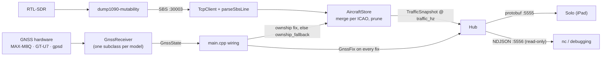
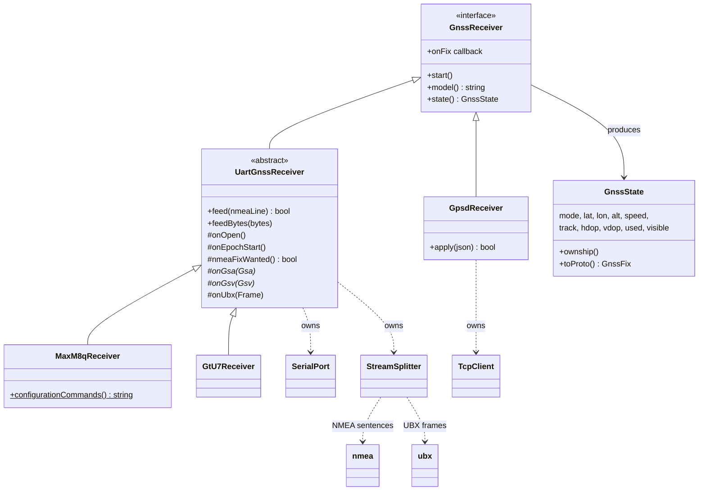

# Dolo architecture

Dolo is the Raspberry Pi half of SoloDolo: a single-process, single-threaded C++20 daemon that merges ADS-B traffic
and ownship GNSS into one protobuf stream for the Solo iPad app. The system-level picture (RF chain, iPad side,
wire protocol) is in [`../docs/architecture.md`](../docs/architecture.md); this document covers what is inside Dolo.

## Boundaries

- Dolo never reads anything from `solo/` (the iOS app). The only shared artifact is the wire contract
  `../proto/solodolo/v1/solodolo.proto`; CMake generates the C++ at build time and nothing generated is committed.
- Dolo does not decode RF or talk to GNSS silicon directly except through a receiver class. ADS-B decoding stays
  in `dump1090-mutability`; Dolo only consumes its SBS text output.

## Data flow

`main.cpp` only wires things together: it builds the receiver from config, connects `onFix` to `Hub::broadcast`,
and runs a timer that turns the `AircraftStore` into a `TrafficSnapshot` using the latest ownship position.

## Execution model

One thread, one `epoll` loop (`event_loop.*`). Everything is non-blocking: the SBS client, the gpsd client, the serial
port, the two listening sockets, every client connection, and timers (traffic snapshots, the hub's hello-timeout
sweep, reconnect retries). There are no locks because nothing runs concurrently. A callback must therefore never
block; slow work does not belong in Dolo.

Both inputs reconnect forever: `TcpClient` retries a dropped socket every 5 s, `SerialPort` retries a missing
or failed device every 5 s. Each logs the outage once rather than on every retry.

## Components

| Module | Responsibility |
|---|---|
| `event_loop.*` | epoll reactor, timers, SIGINT/SIGTERM shutdown |
| `net.*` | non-blocking listener and reconnecting line-oriented `TcpClient` |
| `serial.*` | non-blocking, reconnecting serial port, raw bytes in and out (`SerialPort`) |
| `sbs.*` | parses dump1090 BaseStation lines into per-field updates |
| `aircraft.*` | `AircraftStore`: merges updates per ICAO address, prunes stale tracks, builds `TrafficSnapshot` including range, bearing and relative altitude from ownship |
| `geo.hpp` | great-circle range and bearing |
| `framing.hpp` | 4-byte big-endian length prefix, 1 MiB cap |
| `hub.*` | client handshake, keepalive, fan-out and the JSON debug mirror |
| `config.*` | YAML configuration; unknown keys and bad values are rejected at startup |
| `gnss/*` | GNSS receiver abstraction, see below |

### Hub

- Port 5555 speaks length-prefixed `Envelope`s. The first frame from a client must be a `ClientHello` with a matching
  protocol version, otherwise it is dropped; a client that stays silent for 10 s is dropped too.
- After the handshake the client gets a `ServerHello` and then the latest `GnssFix` and `TrafficSnapshot`, so a new
  or reconnecting app has data immediately instead of waiting for the next update.
- Each client has a bounded queue of whole frames. A slow client loses its oldest unsent frames instead of stalling
  everyone else or growing memory.
- Port 5556 sends the same `Envelope`s as newline-delimited JSON and ignores anything it receives.
- `pps_locked` in `ServerHello` is currently always `false`; Dolo does not discipline the clock from PPS.

### Traffic

`AircraftStore` keeps only what dump1090 sends, merged by ICAO. A full `TrafficSnapshot` is sent every
`1/traffic_hz` seconds (aircraft that disappear from a snapshot are gone). Range and bearing are relative to the
ownship fix; with no usable fix, `ownship_fallback` from the config is used, and without that they are omitted.

## GNSS: one class per piece of hardware

GNSS parts will be swapped, so everything else in Dolo depends on one small interface and never on a model.

| Piece | What it knows |
|---|---|
| `gnss/nmea.*` | NMEA 0183 syntax only: checksum, fields, RMC/GGA/GSA/GSV. No hardware knowledge, no state |
| `gnss/ubx.*` | u-blox UBX binary protocol only: frame encoding and checksum, `UBX-CFG-MSG`, and decoders for NAV-PVT, NAV-DOP and NAV-SAT. No hardware knowledge, no state |
| `gnss/stream.*` | `StreamSplitter`: cuts the UART byte stream into NMEA sentences and checksummed UBX frames (UBX payloads can contain newlines, so lines are not enough) |
| `gnss/state.*` | `GnssState`: the receiver-independent result, and its mapping to the `GnssFix` protobuf |
| `gnss/receiver.hpp` | `GnssReceiver`, the only GNSS type `main.cpp` uses |
| `gnss/uart_receiver.*` | `UartGnssReceiver`: serial port and stream ownership, the RMC/GGA to state mapping every NMEA module shares, and the NMEA publish rule (a `GnssFix` goes out on each GGA) |
| `gnss/max_m8q.*` | u-blox MAX-M8Q, described below |
| `gnss/gt_u7.*` | u-blox GT-U7: GPS only, one GSA and one GSV group per epoch |
| `gnss/gpsd.*` | gpsd's TPV/SKY JSON, for any receiver gpsd already supports |
| `gnss/factory.*` | maps `gnss.receiver` in the config to a class |

Select the hardware with `gnss.receiver` (`max-m8q`, `gt-u7`, `gpsd`) in `dolo.yaml`. To add a model, subclass
`UartGnssReceiver` (or `GnssReceiver` for a different transport), register it in `gnss/factory.cpp` and add a test
that feeds real captured sentences or frames through `feed()` / `feedBytes()`. Nothing else changes.

### The MAX-M8Q: UBX first, NMEA as fallback

`MaxM8qReceiver` asks the module for u-blox's binary messages and uses them as the fix:

- **At startup** (every time the port opens) it sends `UBX-CFG-MSG` commands that switch on NAV-PVT (position,
  velocity, time, accuracy), NAV-DOP (HDOP/VDOP) and NAV-SAT (satellites tracked and used) at 1 Hz. Settings live
  in the module's RAM only; nothing is written to flash, so a power cycle restores its defaults.
- **To make room**, it switches off the NMEA sentences UBX makes redundant (GLL, GSA, GSV, VTG). At 9600 baud
  (about 960 bytes/s) the default NMEA set alone is about 730 bytes/s, and the UBX messages add about 400, so
  without this the module's output queue overflows. RMC and GGA stay on as the fallback.
- **Epochs** are assembled by GPS time of week. The three NAV messages of one epoch arrive in any order (the module
  sends PVT, SAT, DOP); a `GnssFix` goes out as soon as all three are in. If one never arrives, the epoch is
  published when the next one starts instead of being dropped.
- **Fallback:** while NAV-PVT keeps arriving, NMEA RMC/GGA are ignored. After two NMEA epochs without a PVT (the
  module reset and lost its settings, or the TX wire is not connected) the NMEA fix is used instead, the UBX-only
  fields are cleared, and the commands are resent every 10 epochs until UBX returns. Then the NMEA GSA/GSV code
  path combines the per-constellation fix types (best wins) and sums satellites in view across GSV talkers.
- UBX gives what NMEA cannot: `horizontal_error_m` (from hAcc) and `climb_fpm` (from the down velocity), and
  `satellites_visible` counts every tracked satellite, SBAS included. Course over ground is only reported above
  0.5 m/s, because the module's heading is meaningless when stationary.

### Known limits

- Over NMEA (`gt-u7`, or the MAX-M8Q fallback) a `GnssFix` is published at GGA, before that epoch's GSA and GSV
  arrive, so satellites-in-view and VDOP trail the position by one update (1 s at 1 Hz). Over UBX there is no lag.
- For a few seconds after Dolo (re)starts, the module's output queue is still draining the data that overflowed
  before NMEA was cut back, so `fix_unix_ms` in the first reports can be several seconds old. Steady state is about
  0.5 s behind real time.
- `horizontal_error_m` and `climb_fpm` are only filled over UBX (MAX-M8Q) and by gpsd; plain NMEA does not carry them.
- If the GNSS source stops talking, the last fix is not marked stale.

## Configuration and deployment

`config/dolo.yaml` documents every option. With no `--config`, Dolo reads `/etc/dolo/dolo.yaml` if present, else uses
built-in defaults. `deploy/install.sh` installs the packages, `dump1090-mutability`, Dolo, its `systemd` unit and the
`_solodolo._tcp` avahi record; `deploy/start.sh` starts or restarts the whole stack (`dump1090-mutability` first,
then `dolo`). `dolo.service` runs as a dynamic user with the `dialout` group so it can read the GNSS UART.

## Testing

`tests/tests.cpp` builds into `dolo_tests` with no framework: framing, geo, SBS and snapshots, the gpsd, NMEA, GT-U7
and MAX-M8Q receivers (the NMEA tests use sentences captured from the real hardware), config validation, and a hub
integration test over real sockets.
