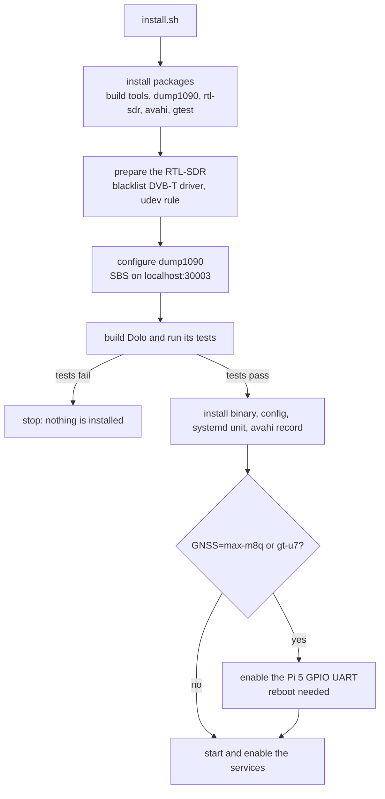

# Dolo

The Raspberry Pi half of SoloDolo (C++20).

- Reads aircraft from `dump1090-mutability` (NooElec RTL-SDR).
- Reads the receiver's own position from a GNSS module (MAX-M8Q or GT-U7 on the Pi's UART) or from gpsd.
- Streams both to the **Solo** iPad app over TCP.

How it is put together: [`ARCHITECTURE.md`](ARCHITECTURE.md). The whole system: [`../docs/architecture.md`](../docs/architecture.md).

## Quick start

On the Pi, from the repository root, as your normal user (the scripts use `sudo` themselves):

```bash
GNSS=max-m8q ./dolo/deploy/install.sh   # leave GNSS=... off for ADS-B only
sudo reboot                             # only if the installer says a reboot is required
./dolo/deploy/start.sh status           # all three services should say "active"
```

- Then point Solo at the Pi's address (`hostname -I`) on port **5555**.
- To watch the data yourself: `nc localhost 5556` (live JSON copy of what Solo receives).



- The installer is **safe to re-run**, and never overwrites an existing `/etc/dolo/dolo.yaml`.
- `GNSS=<receiver>` is only applied when it creates a *new* config. With an existing config, edit its `gnss:` section.
- Other options:
  - `LAT=33.0462 LON=-96.9942 ./dolo/deploy/install.sh` sets the position used when there is no GNSS fix.
  - `./dolo/deploy/install.sh --uninstall` removes Dolo and keeps `/etc/dolo` and dump1090.
  - `./dolo/deploy/install.sh --purge` also deletes `/etc/dolo`.
- Not undone by uninstall: installed packages, dump1090's config, and the UART setting in `/boot/firmware/config.txt`
  (originals are saved next to them as `*.dolo.bak`).

## Everyday commands

| I want to... | Run |
|---|---|
| start everything | `./deploy/start.sh` |
| see what is running (and the latest GNSS report) | `./deploy/start.sh status` |
| apply a config change | edit `/etc/dolo/dolo.yaml`, then `./deploy/start.sh restart` |
| stop everything | `./deploy/start.sh stop` |
| stop it coming back on boot | `sudo systemctl disable dolo dump1090-mutability` |
| watch Dolo's log | `journalctl -u dolo -f` |
| watch the data Solo receives | `nc localhost 5556` |
| remove Dolo | `./deploy/install.sh --uninstall` (or `--purge`) |

- `start.sh` starts dump1090 first, waits for its port, then starts Dolo.
- If Dolo is not installed yet, `start.sh` runs `install.sh` for you.

## Configuration

- File: `/etc/dolo/dolo.yaml` (or `--config <file>`). Every option and its default is in [`config/dolo.yaml`](config/dolo.yaml).
- Unknown keys and invalid values are errors, so typos are caught at startup.

| Key | Default | Meaning |
|---|---|---|
| `server.port` | 5555 | protobuf stream for Solo |
| `server.debug_port` | 5556 | read-only JSON copy; `null` turns it off |
| `adsb.host` / `adsb.port` | 127.0.0.1 / 30003 | where dump1090 serves SBS |
| `adsb.prune_after_s` | 60 | drop aircraft not heard from for this long |
| `gnss.enabled` | `false` | GNSS is off until this is `true` |
| `gnss.receiver` | `max-m8q` | `max-m8q`, `gt-u7` or `gpsd` |
| `gnss.device` | `/dev/ttyAMA0` | serial receivers: the Pi 5 GPIO14/15 UART |
| `gnss.baud` | receiver's own (9600) | serial receivers only |
| `gnss.host` / `gnss.port` | 127.0.0.1 / 2947 | gpsd only |
| `traffic_hz` | 1.0 | how often a `TrafficSnapshot` is sent |
| `ownship_fallback` | not set | position used for range/bearing when there is no GNSS fix |
| `log_level` | `info` | `debug`, `info`, `warning`, `error` |

## GNSS receivers

| `gnss.receiver` | Hardware | Protocol | Gives you |
|---|---|---|---|
| `max-m8q` | u-blox MAX-M8Q HAT (GPS + GLONASS + SBAS) | UBX, falls back to NMEA | everything, including horizontal error and climb rate |
| `gt-u7` | u-blox GT-U7 (GPS only) | NMEA | position, speed, track, satellites, HDOP/VDOP |
| `gpsd` | anything gpsd supports | gpsd JSON | whatever gpsd reports |

For the two serial receivers:
- **Pi 5 UART:** needs `dtparam=uart0=on` in `/boot/firmware/config.txt` and no serial console on it.
  `install.sh` does both when you pass `GNSS=max-m8q` or `GNSS=gt-u7`; reboot afterwards.
- **Wiring** (a HAT does this for you; for a loose module):

  | Module pin | Pi pin |
  |---|---|
  | TX | 10 (GPIO15, RXD) |
  | RX | 8 (GPIO14, TXD) |
  | GND | 6 |
  | VCC | 5V or 3.3V, whichever the board is built for |

- **MAX-M8Q needs both signal wires.** At startup Dolo sends it commands to switch to UBX, and that uses the Pi's TX
  line (pin 8). Without it, the module simply stays on NMEA, and Dolo still works.
- Why UBX and how the fallback works: see [`ARCHITECTURE.md`](ARCHITECTURE.md#the-max-m8q-ubx-first-nmea-as-fallback).

## Troubleshooting

| Symptom | Likely cause | What to do |
|---|---|---|
| Aircraft appear, but no GNSS data | `gnss.enabled` is still `false`, which is the default | set `enabled: true` and `receiver`, then `./deploy/start.sh restart` |
| `ls /dev/ttyAMA0` says "No such file" | the GPIO UART is not enabled yet | `GNSS=max-m8q ./deploy/install.sh`, then `sudo reboot` |
| `start.sh status` says GNSS is enabled but silent | wiring, UART, or the module has no power | check TX goes to pin 10 and RX to pin 8, then `journalctl -u dolo -n 20` |
| The raw UART shows `$GPTXT,01,01,02,u-bl` over and over | the module keeps resetting: power dip or a shorted antenna | reseat the cables, try another power source, and test with the antenna unplugged |
| GNSS works but `horizontal_error_m` and `climb_fpm` are missing | the receiver is on NMEA (`gt-u7`, or the MAX-M8Q's RX wire is not connected) | expected for `gt-u7`; for the MAX-M8Q check the pin 8 wire |
| First GNSS reports after a restart are a few seconds old | the module's output queue is draining | normal; settles to about 0.5 s behind real time |
| No aircraft | dump1090 is not running, or the SDR is busy | `./deploy/start.sh status`; `journalctl -u dump1090-mutability -n 20` |
| Solo shows nothing after Dolo restarted | Solo does not reconnect by itself yet | tap **Connect** in Solo |
| PPS shows "Unlocked" in Solo | expected: Dolo never reports PPS lock | nothing to fix |

## Build and run by hand

For development, without systemd:

1. Install the build dependencies and build:

   ```bash
   sudo apt install cmake g++ protobuf-compiler libprotobuf-dev libyaml-cpp-dev nlohmann-json3-dev libgtest-dev
   cd dolo
   cmake -S . -B build && cmake --build build -j
   ```

2. Run the tests:

   ```bash
   ./build/dolo_tests                          # all tests (GoogleTest)
   ./build/dolo_tests --gtest_filter='Ubx.*'   # just some
   (cd build && ctest --output-on-failure)     # the same, one ctest entry per test
   ```

3. Start dump1090 and wait until its port is open:

   ```bash
   sudo systemctl start dump1090-mutability
   ss -ltn | grep :30003
   ```

   - No dump1090 installed yet? `./deploy/install.sh`, or run it by hand:
     `dump1090-mutability --net --net-sbs-port 30003 --gain -10 --fix --quiet`.

4. Run Dolo and watch it:

   ```bash
   ./build/dolo --config config/dolo.yaml
   nc localhost 5556
   ```

   - Order is forgiving: Dolo retries the SBS connection every 5 s. Traffic just stays empty until dump1090 is up.

5. Stop with `Ctrl-C`, then `sudo systemctl stop dump1090-mutability`.

- Without `--config`, Dolo uses `/etc/dolo/dolo.yaml` if it exists, else built-in defaults.
- To run it by hand against the serial port, your user needs the `dialout` group (you may need to log in again).
- The installed service uses the same ports, so stop it first (`./deploy/start.sh stop`) if you want to run by hand.

## Project layout

| Path | Purpose |
|---|---|
| `src/core/` | event loop, clock, log, `Ownship` |
| `src/io/` | sockets and the serial port |
| `src/adsb/` | SBS parser, aircraft store, range/bearing |
| `src/gnss/` | GNSS receivers (one class per hardware model) |
| `src/server/` | the hub that talks to Solo, and framing |
| `src/app/` | `main.cpp` and the config loader |
| `tests/` | GoogleTest tests, mirroring `src/` |
| `config/dolo.yaml` | every option with its default |
| `deploy/` | `install.sh`, `start.sh`, systemd unit, avahi record |
| `CMakeLists.txt` | top level; each `src/` folder and `tests/` has its own `CMakeLists.txt` and library |

- Dependencies point one way: `core` ← `io` ← `adsb` / `gnss` / `server` ← `app`. Details in [`ARCHITECTURE.md`](ARCHITECTURE.md#components).
- `dolo/` is self-contained: it never reads anything from `solo/` (the iOS app).
- The only shared file is `../proto/solodolo/v1/solodolo.proto`. CMake generates the C++ from it, and nothing generated is committed.

## Adding a GNSS receiver

Each hardware model is its own class behind `GnssReceiver`, so swapping parts never touches `main.cpp`:

1. Subclass `UartGnssReceiver` (a UART module that speaks NMEA, optionally with a vendor binary protocol) and
   implement `onGsa` / `onGsv` for how that module reports fix type and satellites in view.
   Or subclass `GnssReceiver` directly for a different transport.
2. Add the source file to `src/gnss/CMakeLists.txt`.
3. Add one line each to `isKnownGnssReceiver` and `makeGnssReceiver` in `src/gnss/factory.cpp`.
4. Add a `TEST` next to the `MaxM8qReceiver` ones in `tests/gnss/receivers_test.cpp` that feeds real captured
   sentences or frames through `feed()` / `feedBytes()`.

## Status

- **Verified end to end on this Pi:** NooElec NESDR SMArt → dump1090-mutability → Dolo, about 47 aircraft with range and bearing on `:5556`.
- **GNSS:** the NMEA and UBX paths are tested against data captured from a live GT-U7 and MAX-M8Q (3D fix on both).
  The gpsd path is tested against canned messages only.
- **Not yet tested against the Solo app.**
